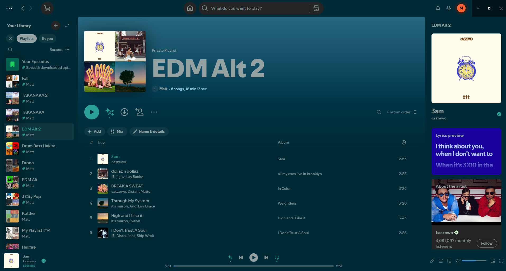

# StudioSample

Midnight teal with warm coral accents, soft rounded cards and a glowing progress bar.



## Color schemes

- `Midnight` (dark, default)
- `Daybreak` (light)

## Install

### Spicetify Marketplace

1. Install [Spicetify](https://spicetify.app) and the [Marketplace](https://github.com/spicetify/marketplace).
2. Open Marketplace in Spotify, go to **Themes**, search for **StudioSample**, and click **Install**.
3. Pick a color scheme from the Marketplace settings.

### Manual

1. Copy this folder to `%APPDATA%\spicetify\Themes\StudioSample` (Windows) or `~/.config/spicetify/Themes/StudioSample` (macOS/Linux).
2. Run:

   ```
   spicetify config current_theme StudioSample color_scheme <Scheme>
   spicetify apply
   ```

Source: https://github.com/BakerBelays/SP_themes
